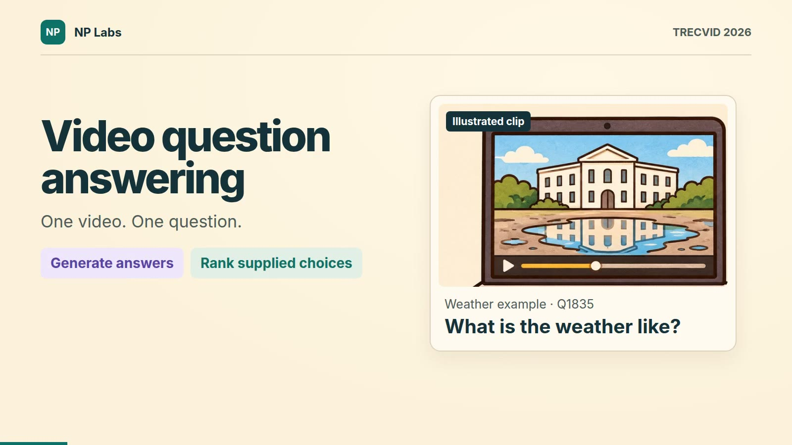

# NP Labs · TRECVID 2026

Our submission to the NIST TRECVID 2026 Video Question Answering track. We
generated answers from video and ranked the organizer’s multiple-choice options.

## [Project site →](https://npatta01.github.io/trec_video_2026/)

**[Watch the approach and scores (1:22)](https://npatta01.github.io/trec_video_2026/#film)** ·
[Paper (PDF)](docs/paper/trecvid2026.pdf) ·
[Workshop slides (HTML)](https://npatta01.github.io/trec_video_2026/docs/workshop/trecvid2026-talk-public.html)

## How we answered video questions

In our Gemini-first run, Gemini supplied the first answer and Qwen supplied
alternatives.

## Official test results

- **Answer generation.** Gemini-first scored **0.318244 on first-answer METEOR**, tied for 2nd of 44 runs using human and alternative references.
- **Multiple choice.** Ranking choices from video with Gemini reached **84.514% top-choice accuracy**, 2nd of 42 runs. Matching the saved answer scored 78.748%.

[See all eight submitted runs and their scores in the paper (PDF)](https://npatta01.github.io/trec_video_2026/docs/paper/trecvid2026.pdf#page=3).

## Repository guide

- [Submission ledger](docs/submissions/README.md) records the runs and organizer validation.
- [Development decisions](docs/project-status/index.md) and [experiment records](docs/experiments/README.md) document the baselines and follow-up studies.
- [Python implementation](src/trec_video_2026/) and [configuration files](configs/) contain the runners and experiment settings.
- [Workshop directory](docs/workshop/) contains the editable talk and local render instructions.
- [Experiment and result guide](docs/project-status/adding-experiments.md) explains how to record new work. [Reports](reports/trecvid_vqa_2026/README.md) and [plans](plans/README.md) preserve historical context.

## Local setup

Install the locked environment with `uv sync`. Run `uv run vqa-frozen30 --help`
to inspect the development benchmark, `uv run vqa-gate --help` for compatibility
checks, or `uv run vqa-download --help` and
`uv run youtube-dataset-download --help` for media tooling.

The competition dataset and raw experiment outputs remain local. On Framework,
linked worktrees use the ignored `data` symlink to the shared dataset. See the
[repository instructions](AGENTS.md#shared-local-dataset) before working with data.
