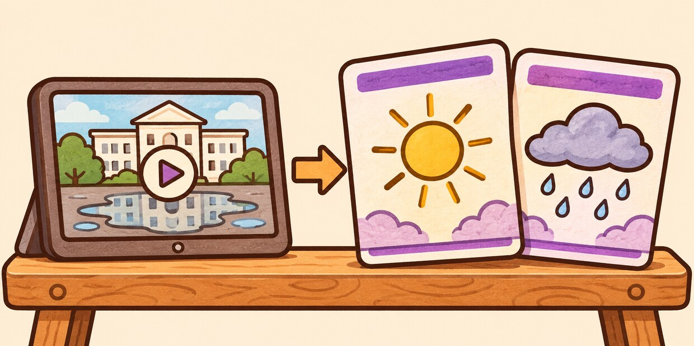

---
# Main talk about 12¾ minutes through slide 21. Slide 22 opens the appendix.
# Visual reference: https://npatta01.github.io/trec_rag_2026/reports/2026-trec-rag-talk.html
# Sources relative to this file:
# - ../paper/trecvid2026-draft.tex, sections 1–4 and appendix A, for method and results.
# - ../paper/question-level-analysis.json, unified_worked_example, ag4_worked_example (Q447), and mc.
# - ../../submissions/trecvid-2026/vqa-ag and vqa-mc-task2-v2 for the exact Q1835 ranks.
# - ../experiments/artifacts/trec-vqa-2026-official-results/README.md and leaderboard-summary.json for organizer scores and ranks.
# - ../paper/shared-error-audit.json, Q2049 and Q1369.
# - Organizer NP_Labs-MC.zip per-query records for Q25, Q55, Q109, and Q576.
# - Organizer NP_Labs.zip, all_references for the AG1/AG3 comparison and the example scores.
# - Frozen Qwen3.6 and Gemini predictions identify the raw answers for Q1, Q120, Q448, Q1573, Q1744, and Q2181.
# - Q448 transcript: original shard 3 requests/448_video-plus-transcript.json, verified against SHA256SUMS and run-manifest.json.
# - Frozen fusion row provenance records Q120 rank 2 as qwen_video_plus_transcript.
# - Adapted from Tanwir Zaman’s trecvid2026-presentation-v7.pdf: pp. 13 (paired chart),
#   14 (weather still), 16 (choice ranks) and 25 (matched transcript comparison).
# - Example stills are recovered from pp. 4–5 of the local paper PDF. See README.md for the build.
# - Cover is an illustration. Q1835 playback, frames, and transcript are sourced
#   from the saved inputs verified by prepare-talk-media.py.
# - Model wordmarks are credited in README.md.
# - Author order from the paper update merged in PR 57 (812564005f1c30aa8058d95018bdde23a02b6ef1).
title: "TRECVID 2026"
subtitle: "Video question answering, traced through one question"
author: "Nidhin Pattaniyil · Tanwir Zaman · Semih Yagli — NP Labs"
lang: en
format:
  revealjs:
    embed-resources: true
    include-after-body:
      - slide-assets/annotations.html
      - slide-assets/video-playback.html
      - slide-assets/slide-jumps.html
      - slide-assets/leaderboards.html
    filters:
      - slide-assets/deck-data.lua
    template-partials:
      - slide-assets/title-slide.html
    html-math-method: mathml
    width: 1280
    height: 760
    margin: 0.06
    slide-number: c/t
    controls: true
    controls-tutorial: false
    transition: none
    center: true
    hash: true
    pdf-separate-fragments: false
    view-distance: 3
    mobile-view-distance: 3
    toc: false
    include-in-header:
      text: |
        <style>
        :root {
          --r-background-color: #fdf1da;
          --r-main-font: Inter, system-ui, sans-serif;
          --r-heading-font: Inter, system-ui, sans-serif;
          --r-main-color: #151a21;
          --r-heading-color: #151a21;
          --r-heading-text-transform: none;
          --r-heading-font-weight: 680;
          --r-heading1-size: 2.46em;
          --r-heading2-size: 1.59em;
          --r-heading3-size: 1.05em;
          --r-main-font-size: 31px;
          --r-link-color: #1f5fa8;
          --deck: #1f5fa8;
          --muted: #515a67;
          --line: #cbbea7;
          --tint: #d7eef7;
          --ag: #603bb7;
          --mc: #0a6d8a;
          --yes: #226d42;
          --warn: #894e09;
        }
        .reveal .slides section { text-align: left; }
        .reveal .slides section h2 { margin-bottom: .44em; line-height: 1.08; }
        .reveal .slides #title-slide, .reveal .slides section.divider {
          background: var(--r-background-color);
          text-align: center;
          box-sizing: border-box;
        }
        .reveal .slides #title-slide h1 { font-size: 2.48em; margin: 0 0 .12em; }
        .reveal .slides #title-slide .subtitle {
          max-width: 34em; margin: 0 auto; font-weight: 620;
          color: var(--muted); font-size: .98em;
        }
        .reveal .slides #title-slide .author { margin: .8em 0 0; font-size: .83em; }
        .reveal .slides #title-slide .cover-mark {
          display: block; width: min(13.5em, 58%); margin: .65em auto .15em;

        }
        .reveal .slides .example-clip {
          display: block;
          width: 100%;
          max-width: none;
          margin: 0;
          aspect-ratio: 16 / 9;
          border-radius: .32em;
          background: #102033;
        }
        .reveal .slides .input-evidence {
          display: grid;
          grid-template-columns: minmax(0, 1.3fr) minmax(0, 1fr);
          gap: .95em;
          align-items: start;
        }
        .reveal .slides .input-evidence h3 {
          margin: 0 0 .25em;
          font-size: .91em;
        }
        .reveal .slides .input-evidence h3 span {
          color: var(--muted);
          font-size: .84em;
          font-weight: 550;
        }
        .reveal .slides .input-evidence .example-clip {
          max-height: 8.5em;
          object-fit: contain;
        }
        .reveal .slides .input-evidence figcaption.input-caption {
          margin-top: .28em;
          font-size: .62em;
          color: var(--muted);
        }
        .reveal .slides .video-inputs {
          margin: .5em 0 0;
          font-size: .72em;
        }
        .reveal .slides .video-inputs > div {
          display: grid;
          grid-template-columns: minmax(0, 1fr) auto;
          column-gap: .55em;
          align-items: baseline;
          padding: .3em 0;
          border-top: 1px solid var(--line);
        }
        .reveal .slides .video-inputs dt { font-weight: 650; }
        .reveal .slides .video-inputs dd { margin: 0; }
        .reveal .slides .video-inputs .input-model { color: var(--ag); font-weight: 650; }
        .reveal .slides .video-inputs .input-quote {
          grid-column: 1 / -1;
          color: var(--muted);
          margin-top: .15em;
        }
        .reveal .slides .sampled-frames {
          display: grid;
          grid-template-columns: repeat(4, minmax(0, 1fr));
          gap: .30em .35em;
          margin: .3em 0;
        }
        .reveal .slides .sampled-frames figure { margin: 0; }
        .reveal .slides .sampled-frames img {
          display: block;
          width: 100%;
          max-width: none;
          margin: 0;
          border-radius: .15em;
        }
        .reveal .slides .sampled-frames figcaption {
          margin-top: .13em;
          font-size: .55em;
          color: var(--muted);
          font-variant-numeric: tabular-nums;
        }
        .reveal .slides .generation-scores {
          display: grid;
          gap: 1.40em;
        }
        .reveal .slides .generation-scores table {
          width: 100%;
          margin: 0;
          table-layout: fixed;
          font-size: .72em;
          font-variant-numeric: tabular-nums;
        }
        .reveal .slides .generation-scores caption {
          text-align: left;
          margin-bottom: .18em;
          font-size: 1.17em;
          font-weight: 680;
        }
        .reveal .slides .generation-scores :is(th, td) {
          padding: .15em .55em;
          border-bottom: 1px solid var(--line);
          text-align: left;
        }
        .reveal .slides .generation-scores :is(th, td):first-child { width: 39%; }
        .reveal .slides .generation-scores tr > :nth-child(3) { background: #ebe5ff; }
        .reveal .slides .generation-scores .metric-win { color: var(--ag); font-weight: 750; }
        .reveal .slides .generation-scores .trace-foot { margin: .27em 0 0; }
        .reveal .slides .generation-scores .metric-callout {
          margin: .35em 0 0;
          padding: .36em .55em;
          border-left: .16em solid var(--ag);
          background: #ebe5ff;
          color: #442584;
          font-size: .75em;
          font-weight: 700;
        }
        .reveal .slides #ag-results-summary .slide-body { margin-block: .18em auto; }
        .reveal .slides .metric-definitions {
          display: grid;
          grid-template-columns: repeat(3, minmax(0, 1fr));
          gap: .6em;
          margin: .28em 0 .44em;
          padding: .4em .58em;
          background: #efe4ce;
          font-size: .73em;
        }
        .reveal .slides .metric-scope {
          margin: .12em 0 .84em;
          font-size: .66em;
          color: var(--muted);
        }
        .reveal .slides .deck-icon {
          width: 1.45em;
          height: 1.45em;
          flex: 0 0 auto;
          vertical-align: middle;
        }
        .reveal .slides .task-flow {
          display: grid;
          grid-template-columns: minmax(0, .84fr) 2.55em minmax(0, 1.16fr);
          align-items: center;
          gap: .7em;
          min-height: 13em;
          margin: .5em 0;
        }
        .reveal .slides .task-input {
          background: #f9ebcc;
          border: 2px solid var(--warn);
          color: var(--r-main-color);
          min-height: 10.6em;
          border-radius: .52em;
          display: grid;
          align-content: center;
          justify-items: center;
          text-align: center;
        }
        .reveal .slides .task-input .deck-icon { width: 3em; height: 3em; color: var(--warn); }
        .reveal .slides .task-split .deck-icon { width: 2.55em; height: 2.55em; color: var(--deck); }
        .reveal .slides .task-output > div {
          display: grid;
          grid-template-columns: 1.8em 1fr;
          align-items: center;
          gap: .6em;
          padding: .48em .63em;
          border-left: .13em solid currentColor;
          border-radius: .24em;
          background: #ebe5ff;
        }
        .reveal .slides .task-output > div + div { margin-top: .55em; background: #d7eef7; }
        .reveal .slides .task-output .deck-icon { width: 1.7em; height: 1.7em; }
        .reveal .slides .task-output p, .reveal .slides .task-input p { margin: .12em 0; }
        .reveal .slides .task-output small { display: block; color: #394659; font-size: .7em; }
        .reveal .slides .task-output .task-example { margin-top: .26em; font-size: .74em; }
        .reveal .slides .example-layout {
          display: grid;
          grid-template-columns: minmax(0, 1.62fr) minmax(0, .88fr);
          align-items: center;
          gap: 1em;
        }
        .reveal .slides #generation-example .example-layout {
          grid-template-columns: minmax(0, 1.3fr) minmax(0, 1fr);
        }
        .reveal .slides .example-layout figure { margin: 0; }
        .reveal .slides .example-layout figcaption {
          margin-top: .34em;
          font-size: .63em;
          color: var(--muted);
        }
        .reveal .slides .example-question {
          font-size: 1.16em;
          line-height: 1.22;
          font-weight: 680;
          margin: .36em 0 .58em;
        }
        .reveal .slides .answer-key {
          border-left: .13em solid var(--yes);
          padding-left: .55em;
          font-size: .79em;
        }
        .reveal .slides .answer-key strong { font-size: 1.44em; display: block; }
        .reveal .slides .approach-grid {
          display: grid;
          grid-template-columns: repeat(4, minmax(0, 1fr));
          gap: .65em;
          margin-top: .95em;
        }
        .reveal .slides .approach-grid > div {
          min-height: 9.2em;
          padding: .65em .48em .45em;
          background: #f4ead6;
          border-top: .13em solid var(--deck);
          border-radius: .27em;
          text-align: center;
        }
        .reveal .slides .approach-grid .deck-icon { width: 2.9em; height: 2.9em; color: var(--deck); }
        .reveal .slides .approach-grid h3 { font-size: .96em; margin: .4em 0 .24em; }
        .reveal .slides .approach-grid p { color: var(--muted); font-size: .73em; margin: 0; }
        .reveal .slides .model-version { display: inline-flex; align-items: center; gap: .35em; }
        .reveal .slides .model-version img { width: 3.35em; max-height: 1.25em; object-fit: contain; margin: 0; }
        .reveal .slides .model-version .gemini-logo { width: 3.75em; }
        .reveal .slides .source-paths {
          display: grid;
          grid-template-columns: 1.2fr auto 1fr;
          gap: .46em .5em;
          align-items: center;
          font-size: .87em;
        }
        .reveal .slides .source-paths .path-label { color: var(--muted); font-size: .72em; font-weight: 650; }
        .reveal .slides .source-paths .path-input,
        .reveal .slides .path-title { display: flex; align-items: center; gap: .47em; font-weight: 650; }
        .reveal .slides .source-paths .path-input .deck-icon,
        .reveal .slides .source-paths .path-arrow { color: var(--deck); }
        .reveal .slides .rank-result {
          display: flex;
          align-items: center;
          gap: .55em;
          margin-top: .45em;
          padding-top: .5em;
          border-top: 2px solid var(--line);
        }
        .reveal .slides .rank-result small { color: var(--muted); }
        .reveal .slides .accuracy-layout {
          display: grid;
          grid-template-columns: minmax(0, 2.15fr) minmax(0, .85fr);
          align-items: center;
          gap: .9em;
          margin-top: .65em;
        }
        .reveal .slides .accuracy-bars { display: grid; row-gap: .65em; font-size: .79em; }
        .reveal .slides .accuracy-row {
          display: grid;
          grid-template-columns: 12em minmax(0, 1fr) 4.4em;
          gap: .48em;
          align-items: center;
        }
        .reveal .slides .accuracy-row meter { width: 100%; height: .75em; appearance: none; }
        .reveal .slides .accuracy-row meter::-webkit-meter-bar {
          background: #ebdfc6;
          border: 0;
          border-radius: 0;
        }
        .reveal .slides .accuracy-row meter::-webkit-meter-optimum-value { background: #779abf; }
        .reveal .slides .accuracy-row.featured meter::-webkit-meter-optimum-value { background: var(--mc); }
        .reveal .slides .accuracy-row.featured { color: var(--mc); font-weight: 750; }
        .reveal .slides .accuracy-row strong { font-variant-numeric: tabular-nums; }
        .reveal .slides .accuracy-summary { border-left: 2px solid var(--line); padding-left: .65em; }
        .reveal .slides .accuracy-summary p { margin: .22em 0; }
        .reveal .slides .accuracy-summary .metric { line-height: 1; font-size: 1.8em; }
        .reveal .slides .accuracy-summary small { color: var(--muted); }
        .reveal .slides section.divider h2 { font-size: 2.02em; color: #07394a; }
        .reveal .slides :is(.kicker, .source) { color: var(--muted); font-size: .63em; }
        .reveal .slides .kicker {
          color: var(--deck);
          font-weight: 700;
          letter-spacing: .06em;
          text-transform: uppercase;
        }
        .reveal .slides .source { margin-top: 1.2em; }
        .reveal .slides .source p { margin: 0; }
        .reveal .slides .caption {
          margin: .9em 0 0;
          border-top: 2px solid var(--line);
          padding-top: .6em;
          font-size: .83em;
          color: var(--muted);
        }
        .reveal .slides .caption p { margin: 0; }
        .reveal .slides .pair {
          display: grid;
          grid-template-columns: 1fr 1fr;
          gap: 1.25em;
          margin: .6em 0 .2em;
          align-items: start;
        }
        .reveal .slides .branch { padding-left: .65em; border-left: 5px solid var(--deck); }
        .reveal .slides .branch p { margin: .28em 0; }
        .reveal .slides .ag { color: var(--ag); }
        .reveal .slides .mc { color: var(--mc); }
        .reveal .slides .yes { color: var(--yes); }
        .reveal .slides .warn { color: var(--warn); }
        .reveal .slides .answer { font-size: 1.34em; font-weight: 680; }
        .reveal .slides .question {
          background: #fffdf8;
          border-left: 7px solid var(--deck);
          padding: .55em .85em;
          margin: .45em 0;
          font-size: 1.18em;
          font-weight: 620;
        }
        .reveal .slides .question p { margin: 0; }
        .reveal .slides .steps { margin: .5em 0; font-size: .92em; }
        .reveal .slides .steps p { margin: .34em 0; }
        .reveal .slides .steps b { color: var(--deck); }
        .reveal .slides table { width: 100%; font-size: .80em; }
        .reveal .slides th { color: var(--deck); }
        .reveal .slides th, .reveal .slides td {
          padding: .38em .42em;
          border-bottom-color: var(--line);
        }
        .reveal .slides .metric {
          color: var(--mc);
          font-size: 2.06em;
          font-weight: 730;
          letter-spacing: -.03em;
          font-variant-numeric: tabular-nums;
        }
        .reveal .slides .leader { background: var(--tint); }
        .reveal .slides .leader td:first-child { font-weight: 700; }
        .reveal .slides .weather-case {
          grid-template-columns: minmax(0, 1fr) minmax(0, 1.12fr);
          gap: 1em;
          align-items: center;
        }
        .reveal .slides .weather-case figure { margin: 0; }
        .reveal .slides .weather-case figure img {
          display: block;
          width: 100%;
          max-width: 100%;
          margin: 0 0 .2em;
        }
        .reveal .slides .weather-case figcaption { color: var(--muted); font-size: .62em; }
        .reveal .slides .weather-case .branch { margin-top: .6em; font-size: .8em; }
        .reveal .slides .weather-case .question { margin-top: 0; font-size: 1.05em; }
        .reveal .slides .visual-flow, .reveal .slides .visual-compare, .reveal .slides .closing-evidence {
          display: grid;
          align-items: center;
          gap: 1em;
          margin: .7em 0;
        }
        .reveal .slides .visual-flow { grid-template-columns: 1.1fr auto .8fr; }
        .reveal .slides .visual-compare, .reveal .slides .closing-evidence { grid-template-columns: 1fr 1fr; }
        .reveal .slides .visual-compare { align-items: start; }
        .reveal .slides .visual-compare > div + div, .reveal .slides .closing-evidence > div + div {
          border-left: 2px solid var(--line);
          padding-left: 1em;
        }
        .reveal .slides .group + .group { margin-top: .55em; }
        .reveal .slides .group span { font-weight: 720; }
        .reveal .slides .group small, .reveal .slides .visual-ranks small {
          display: block;
          font-size: .72em;
          color: var(--muted);
        }
        .reveal .slides .visual-ranks { display: block; margin: 0 0 0 .95em; }
        .reveal .slides .visual-ranks li { padding-left: .22em; }
        .reveal .slides .visual-ranks li:last-child { list-style: none; }
        .reveal .slides .visual-arrow { color: var(--deck); font-size: 1.44em; }
        .reveal .slides .visual-input { color: var(--muted); font-size: .77em; }
        .reveal .slides .visual-choice { font-size: 1.65em; font-weight: 740; margin: 0; }
        .reveal .slides .visual-result {
          display: flex;
          flex-wrap: wrap;
          align-items: baseline;
          gap: .3em .55em;
          border-top: 2px solid var(--line);
          margin-top: .75em;
          padding-top: .52em;
          font-size: .83em;
        }
        .reveal .slides .visual-result strong { font-size: 1.3em; }
        .reveal .slides .visual-result small { color: var(--muted); font-size: .81em; }
        .reveal .slides .score-visual { margin: .9em 0; }
        .reveal .slides .score-visual > div {
          display: grid;
          grid-template-columns: 6.8em minmax(0, 1fr) 2.9em;
          align-items: center;
          gap: .55em;
          margin: .55em 0;
        }
        .reveal .slides .score-visual meter { width: 100%; height: .9em; }
        .reveal .slides .score-visual meter::-webkit-meter-bar { background: #e9dcc7; border: 0; }
        .reveal .slides .score-visual meter::-webkit-meter-optimum-value { background: var(--ag); }
        .reveal .slides .closing-number { display: block; font-size: 1.95em; font-weight: 750; }
        .reveal .slides .closing-evidence p { font-size: .83em; color: var(--muted); }
        .reveal .slides .case-rail {
          display: flex;
          align-items: center;
          gap: .58em;
          margin: 0 0 .55em;
        }
        .reveal .slides .case-rail img {
          display: block;
          width: 4.1em;
          max-width: none;
          border-radius: .2em;
          margin: 0;
        }
        .reveal .slides .case-rail { font-size: .67em; }
        .reveal .slides .trace-label {
          display: block;
          color: #815112;
          font-size: .68em;
          font-weight: 680;
          letter-spacing: .045em;
          text-transform: uppercase;
        }
        .reveal .slides .trace-foot { color: var(--muted); font-size: .67em; margin-top: .7em; }
        .reveal .slides .assembly-grid, .reveal .slides .result-trio {
          display: grid;
          grid-template-columns: repeat(3, minmax(0, 1fr));
          gap: .72em;
          margin-top: .45em;
        }
        .reveal .slides .assembly-grid > div, .reveal .slides .result-trio > div {
          border-top: .15em solid var(--ag);
          padding: .45em .5em;
          background: #ebe5ff;
          border-radius: .18em;
        }
        .reveal .slides .assembly-grid h3 { font-size: .99em; margin: .28em 0; }
        .reveal .slides .answer-ranks {
          display: grid;
          margin: .2em 0 0;
          padding: 0;
          list-style: none;
          font-size: .81em;
        }
        .reveal .slides .answer-ranks li {
          display: grid;
          grid-template-columns: 1.65em 1fr;
          align-items: baseline;
          padding: .18em 0;
        }
        .reveal .slides .answer-ranks li + li { border-top: 1px solid #cbbea7; }
        .reveal .slides .rank-number { font-size: .8em; color: var(--muted); font-weight: 700; }
        .reveal .slides .rewrite-flow { margin: .24em 0 0; }
        .reveal .slides .rewrite-flow .meaning-groups { align-self: start; padding-top: .35em; }
        .reveal .slides .rewrite-flow .group { margin-top: .42em; }
        .reveal .slides .trace-still img { display: block; width: 100%; max-width: none; margin: 0; border-radius: .25em; }
        .reveal .slides .choice-bank {
          display: grid;
          grid-template-columns: 1fr 1fr;
          list-style: none;
          gap: .25em .5em;
          margin: .5em 0 0;
          padding: 0;
          font-size: .78em;
        }
        .reveal .slides .choice-bank li { padding: .15em 0; border-bottom: 1px solid var(--line); }
        .reveal .slides .ranking-chart { display: grid; gap: .28em; font-size: .71em; }
        .reveal .slides .ranking-lane {
          display: grid;
          grid-template-columns: minmax(0, 2.7fr) repeat(8, minmax(0, 1fr));
          align-items: center;
          gap: .24em;
        }
        .reveal .slides .ranking-lane span {
          background: #efe4ce;
          border-radius: .22em;
          padding: .25em .08em;
          text-align: center;
          color: var(--muted);
        }
        .reveal .slides .ranking-lane span.yes { color: var(--yes); background: #ddf2e3; font-weight: 750; }
        .reveal .slides .ranking-lane span.warn { color: var(--warn); background: #faecc7; font-weight: 750; }
        .reveal .slides .ranking-axis span { background: transparent; }
        .reveal .slides .ranking-method small { display: block; color: var(--muted); }
        .reveal .slides .count-still > div { position: relative; }
        .reveal .slides .hat-marker {
          position: absolute; top: 41%; left: 15.5%; width: 8%; aspect-ratio: 1;
          border: .12em solid #ffe48b; border-radius: 50%; box-shadow: 0 0 0 2px #192331;
          transform: translate(-50%, -50%); pointer-events: none;
        }
        .reveal .slides .takeaway-grid {
          display: grid;
          grid-template-columns: repeat(2, minmax(0, 1fr));
          gap: .85em;
        }
        .reveal .slides .takeaway-grid article {
          padding: .72em .82em;
          background: #ebe5ff;
          border-top: .15em solid var(--ag);
          border-radius: .16em;
        }
        .reveal .slides .takeaway-grid article + article {
          background: #d7eef7;
          border-color: var(--mc);
        }
        .reveal .slides .takeaway-grid h3 { margin: 0 0 .45em; font-size: 1.04em; }
        .reveal .slides .takeaway-grid ul {
          display: block;
          margin: 0;
          padding-left: 1.1em;
          font-size: .84em;
        }
        .reveal .slides .takeaway-grid li + li { margin-top: .42em; }
        .reveal .slides .takeaway-grid li strong { white-space: nowrap; }
        .reveal .slides .takeaway-grid .takeaway-metric { margin: 0 0 .5em; font-size: .84em; }
        .reveal .slides .answer-check { font-weight: 800; }
        .reveal .slides .mc-results-headline { color: #095871; }
        .reveal .slides :is(.sts-leaderboard, .leaderboard-overview) { width: 100%; font-size: .75em; font-variant-numeric: tabular-nums; }
        .reveal .slides :is(.sts-leaderboard, .leaderboard-overview) caption { text-align: left; margin-bottom: .45em; font-size: .93em; }
        .reveal .slides .sts-leaderboard tr.leaderboard-team { background: #ebe5ff; }
        .reveal .slides .leaderboard-overview :is(th, td) { padding: .36em .48em; }
        .reveal .slides .leaderboard-overview :is(th, td):last-child { white-space: nowrap; }
        .reveal .slides .leaderboard-overview td:nth-child(3) { background: #ebe5ff; }
        .reveal .slides .leaderboard-tools {
          display: flex;
          flex-wrap: wrap;
          align-items: end;
          gap: .48em .8em;
          font-size: .74em;
          margin-bottom: .52em;
        }
        .reveal .slides .leaderboard-tools label { display: grid; gap: .18em; }
        .reveal .slides .leaderboard-tools :is(select, button) {
          padding: .24em .42em;
          border: 1px solid var(--line);
          border-radius: .18em;
          background: #fff8e9;
          color: var(--r-main-color);
          font: inherit;
        }
        .reveal .slides .leaderboard-tools button { cursor: pointer; }
        .reveal .slides .leaderboard-scroll {
          height: 16em;
          overflow: auto;
          overscroll-behavior: contain;
          border: 1px solid var(--line);
        }
        .reveal .slides .leaderboard-full {
          width: 100%;
          margin: 0;
          font-size: .74em;
          font-variant-numeric: tabular-nums;
        }
        .reveal .slides .leaderboard-full :is(td, th) { padding: .28em .55em; }
        .reveal .slides .leaderboard-full thead {
          position: sticky;
          top: 0;
          background: #efe4ce;
          z-index: 1;
        }
        .reveal .slides .leaderboard-full td { white-space: nowrap; }
        .reveal .slides .leaderboard-full th[scope="row"] { overflow-wrap: anywhere; }
        .reveal .slides .leaderboard-full .leaderboard-team { background: #ebe5ff; }
        .reveal .slides .leaderboard-full small { display: block; font-size: .77em; color: var(--ag); }
        .reveal .slides .leaderboard-full tr:focus-visible { outline: .12em solid var(--ag); outline-offset: -.12em; }
        .reveal .slides .count-result > div, .reveal .slides .closing-trace > div {
          padding: .4em 0;
          border-top: 1px solid var(--line);
        }
        .reveal .slides .count-result strong, .reveal .slides .closing-trace strong { display: block; }
        .reveal .slides .closing-trace small { font-size: .7em; color: var(--muted); }
        .reveal .slides .result-trio > div > * { display: block; }
        .reveal .slides .result-trio strong { font-size: 1.2em; }
        .reveal .slides .result-trio div > span:nth-child(3) { font-weight: 730; font-size: 1.6em; color: var(--ag); }
        .reveal .slides .result-trio small { color: var(--muted); font-size: .72em; }
        .reveal .slides .flow-node {
          display: grid; gap: .12em; background: #d7eef7;
          padding: .44em .56em; border-left: .13em solid var(--mc);
        }
        .reveal .slides .flow-node strong { font-size: 1.24em; }
        .reveal .slides .flow-node span:not(.trace-label) { font-size: .75em; }
        .reveal .slides .gate-outputs { display: grid; gap: .36em; }
        .reveal .slides .rewrite-full { display: grid; grid-template-columns: 1fr 1fr; gap: 1em; }
        .reveal .slides .dev-scores > div { grid-template-columns: 7.5em minmax(0, 1fr) 3.8em; }
        .reveal .slides .live-results > div { grid-template-columns: 13em minmax(0, 1fr) 4.2em; }
        .reveal .slides #results-summary .live-results > div { grid-template-columns: 13em minmax(0, 1fr) 4.6em; }
        .reveal .slides #results-summary .live-results b { text-align: right; }
        .reveal .slides .live-results meter::-webkit-meter-optimum-value { background: var(--mc); }
        .reveal .slides .backup-nav {
          display: grid; grid-template-columns: 1fr 1fr; gap: .65em 1em; margin: .9em auto 0;
          max-width: 24em; font-size: .85em;
        }
        .reveal .slides .backup-nav a { text-decoration: underline; padding: .32em .2em; }
        .reveal .slides .assembly-count { font-size: .62em; color: var(--ag); margin: .15em 0 .5em; }
        .reveal .slides .assembly-paths { display: grid; gap: .7em; }
        .reveal .slides .assembly-paths > div {
          display: grid; grid-template-columns: 1fr auto 1.24fr; align-items: center;
          column-gap: .55em; padding: .55em .6em; border-left: .14em solid var(--ag);
          background: #ebe5ff; border-radius: .2em;
        }
        .reveal .slides .assembly-paths .trace-label { grid-column: 1 / -1; margin-bottom: .22em; }
        .reveal .slides .choice-paths > div { grid-template-columns: 1.45fr auto .8fr; background: #d7eef7; border-color: var(--mc); }
        .reveal .slides .choice-paths .trace-label { color: #24566b; }
        .reveal .slides .choice-paths small { display: block; font-size: .65em; color: var(--muted); }
        .reveal .slides .choice-video-input { display: flex; align-items: center; gap: .55em; }
        .reveal .slides .choice-video-input a { flex: 0 0 3.9em; }
        .reveal .slides .choice-video-input img {
          display: block; width: 100%; max-width: none; margin: 0; border-radius: .15em;
        }
        .reveal .slides .ranking-cases {
          display: grid;
          grid-template-columns: repeat(2, minmax(0, 1fr));
          gap: .9em;
        }
        .reveal .slides .ranking-cases h3 { font-size: .94em; margin: 0 0 .32em; }
        .reveal .slides .ranking-cases figure { margin: 0; }
        .reveal .slides .ranking-cases img {
          height: 8.5em;
          object-fit: contain;
          background: #eee1c6;
        }
        .reveal .slides .ranking-cases figcaption { margin-top: .2em; font-size: .6em; color: var(--muted); }
        .reveal .slides .ranking-cases .case-question { min-height: 2.6em; font-size: .86em; font-weight: 680; margin: .44em 0; }
        .reveal .slides .ranking-cases dl { display: block; margin: 0; font-size: .75em; }
        .reveal .slides .ranking-cases dl div {
          display: flex;
          justify-content: space-between;
          gap: .5em;
          border-top: 1px solid var(--line);
          padding: .27em 0;
        }
        .reveal .slides .ranking-cases dt { color: var(--muted); }
        .reveal .slides .ranking-cases dd { margin: 0; font-weight: 720; }
        .reveal .slides .ranking-cases .example-clip {
          max-height: 8.5em;
          object-fit: contain;
        }
        .reveal .slides :is(#ag-case-comparison, #ag-wording-examples) .case-question { min-height: 0; }
        .reveal .slides :is(#ranking-image-examples, #counting-example) .ranking-cases dd { text-align: right; }
        .reveal .slides .ranking-image-cases dl dt { flex: 0 0 40%; }
        .reveal .slides .generation-cases .example-clip { max-height: 6.5em; }
        .reveal .slides .generation-cases dl.ag-answers { font-size: .64em; }
        .reveal .slides .ag-single-example { grid-template-columns: minmax(0, 1.03fr) minmax(0, 1fr); }
        .reveal .slides .speech-transcript {
          margin-top: .58em;
          padding: .44em .58em;
          background: #ebe5ff;
          border-left: .18em solid var(--ag);
          font-size: .66em;
        }
        .reveal .slides .speech-transcript blockquote {
          display: grid;
          grid-template-columns: max-content minmax(0, 1fr);
          gap: .19em .55em;
          width: auto;
          margin: .27em 0 0;
          padding: 0;
          background: transparent;
          border: 0;
          color: var(--r-main-color);
          box-shadow: none;
          font-style: normal;
        }
        .reveal .slides .speech-time { color: var(--ag); font-variant-numeric: tabular-nums; }
        .reveal .slides #ag-speech-example .ag-answers > div:nth-child(3) { background: #ebe5ff; }
        .reveal .slides .ag-answers { display: block; margin: 0; font-size: .72em; }
        .reveal .slides dl.ag-answers > div {
          display: grid;
          grid-template-columns: minmax(0, 1.08fr) minmax(0, 1.4fr);
          column-gap: .55em;
          padding: .23em 0;
          border-top: 1px solid var(--line);
        }
        .reveal .slides .ag-answers dt { color: var(--muted); font-weight: 640; }
        .reveal .slides .ag-answers dd {
          display: grid;
          grid-template-columns: minmax(0, 1fr) 2.85em;
          column-gap: .32em;
          align-items: baseline;
          margin: 0;
          font-weight: 680;
          text-align: right;
        }
        .reveal .slides .ag-answers dd small {
          color: var(--ag);
          font-size: inherit;
          font-variant-numeric: tabular-nums;
        }
        .reveal .slides .equivalent-cases .count-still > div { width: min(100%, 15.11em); margin: 0 auto; }
        .reveal .slides #ag-case-comparison .trace-foot { margin-bottom: 0; }
        .reveal .slides .metric-contrast {
          display: flex; flex-wrap: wrap; gap: .25em .8em;
          align-items: baseline; margin-top: .65em; padding-top: .5em;
          border-top: 1px solid var(--line); font-size: .82em;
        }
        .reveal .slides .metric-contrast strong { color: var(--ag); }

        .reveal .slides .assembly-paths span[aria-hidden] { color: var(--ag); }
        .reveal .slides .metric-intro > div { padding: .55em .6em; background: #ebe5ff; border-radius: .2em; }
        .reveal .slides .metric-intro small { display: block; color: var(--muted); font-size: .72em; }
        .reveal .slides > section.present.content-slide {
          top: 0 !important; height: 100%; padding: .2em 0 .18em; box-sizing: border-box;
          display: flex !important; flex-direction: column;
        }
        .reveal .slides .content-slide > h2 { font-size: 1.45em; margin: 0 0 .22em; }
        .reveal .slides .slide-body { margin-block: auto; }
        .reveal .slides .section-art { max-width: 30em; margin: .22em auto 0; }
        .reveal .slides .section-art img {
          display: block; width: 100%; max-width: 100%; max-height: 15em;
          object-fit: contain; margin: 0;
        }
        .reveal .slides .divider:has(.section-art) > h2 { margin-bottom: .15em; }
        .reveal .slides .divider .section-lead { color: var(--muted); font-size: .83em; margin: .38em 0 0; }
        .reveal .slides .roadmap {
          display: grid; gap: .42em; margin: .6em 0 0; padding: 0;
          list-style: none; counter-reset: talk-section; text-align: left;
        }
        .reveal .slides .roadmap li {
          display: grid; grid-template-columns: 1.45em 1fr; align-items: baseline;
          padding: .47em .68em; border-left: 3px solid transparent; color: var(--muted);
          font-weight: 680; counter-increment: talk-section;
        }
        .reveal .slides .roadmap li::before {
          content: counter(talk-section); color: var(--mc); font-size: .75em; font-weight: 750;
        }
        .reveal .slides .roadmap li:first-child { background: var(--tint); border-color: var(--mc); }
        .reveal .slides .roadmap a { color: inherit; }
        .reveal .slides .roadmap a:focus-visible, .reveal .slides .roadmap a:hover { text-decoration: underline; }
        .reveal .slides .roadmap-caption { color: var(--muted); font-size: .65em; margin-top: 1.6em; }
        .reveal .slides .choice-paths > div { border: 1px solid var(--mc); border-left-width: .13em; }
        .reveal .slides #ag-results-summary meter::-webkit-meter-optimum-value { background: var(--ag); }
        .reveal .slides #results-summary .score-visual > div:first-child meter::-webkit-meter-optimum-value { background: #7e8582; }
        .reveal .slides #paired-changes .score-visual > div:first-child meter::-webkit-meter-optimum-value { background: var(--yes); }
        .reveal .slides #paired-changes .score-visual > div:nth-child(2) meter::-webkit-meter-optimum-value { background: var(--warn); }
        @media (prefers-reduced-motion: reduce) {
          .reveal .slides section, .reveal .fragment { transition: none !important; }
        }
        @media print {
          .reveal .slides #title-slide, .reveal .slides section.divider { print-color-adjust: exact; }
        }
        </style>
---

## What we will walk through {#roadmap .divider}

```{=html}
<ol class="roadmap">
  <li><a href="#/weather-question">The video question</a></li>
  <li><a href="#/transition-ag">Answer generation</a></li>
  <li><a href="#/transition-mc">Multiple choice</a></li>
  <li><a href="#/takeaways">Conclusion</a></li>
</ol>
<p class="roadmap-caption">Two tasks traced through one weather clip.</p>
```

::: {.notes}
0:12. Preview the two tasks and their shared clip. The multiple-choice section ends with the full-test ranking comparison.
:::

## Two outputs from the same video question {#two-outputs .content-slide}

:::::: {.slide-body}

[The TRECVID VQA task]{.kicker}

```{=html}
<div class="task-flow">
  <div class="task-input">
    <svg class="deck-icon" aria-hidden="true" viewBox="0 0 24 24" fill="none" stroke="currentColor" stroke-width="1.65" stroke-linecap="round" stroke-linejoin="round"><rect x="2" y="4" width="20" height="16" rx="2"/><path d="m10 8 6 4-6 4z"/></svg>
    <p><strong>Video + question</strong></p>
  </div>
  <div class="task-split"><svg class="deck-icon" aria-hidden="true" viewBox="0 0 24 24" fill="none" stroke="currentColor" stroke-width="1.65" stroke-linecap="round" stroke-linejoin="round"><path d="M3 12h7m0 0V6h8m-8 6v6h8m-3-15 3 3-3 3m0 6 3 3-3 3"/></svg></div>
  <div class="task-output">
    <div class="ag"><svg class="deck-icon" aria-hidden="true" viewBox="0 0 24 24" fill="none" stroke="currentColor" stroke-width="1.65" stroke-linecap="round" stroke-linejoin="round"><path d="M3 4h18v13H9l-6 4zM7 8h10M7 12h7"/></svg><p><strong>Generate answers</strong><small>Write ten ranked answers</small><span class="task-example">e.g. “It is sunny.”</span></p></div>
    <div class="mc"><svg class="deck-icon" aria-hidden="true" viewBox="0 0 24 24" fill="none" stroke="currentColor" stroke-width="1.65" stroke-linecap="round" stroke-linejoin="round"><path d="M10 5h11M10 12h11M10 19h11M3 4h2v4M3 11h3v2H3v2h3m-3 3h3v4H3m1-2h2"/></svg><p><strong>Rank the choices</strong><small>Order the supplied choices</small><span class="task-example">e.g. Sunny → Cloudy → Rainy</span></p></div>
  </div>
</div>
```

::::::

::: {.notes}
1:05 including the cover. We used pretrained models with no task-specific fine-tuning. The two tasks give us a useful comparison because the question stays the same and the required output changes. The generation task expects a ranked list of ten answers. Multiple choice supplies the options and asks for a ranking.
:::

## The video question we’ll follow {#weather-question .content-slide}

:::::: {.slide-body}

```{=html}
<div class="example-layout">
  <figure>
    <video class="example-clip" controls muted playsinline preload="metadata"
           poster="../paper/private-frames/weather-02.jpg"
           src="../paper/private-frames/weather-clip-av.mp4"
           aria-label="Play the five-second Q1835 test video"></video>
    <figcaption>Q1835 · 5-second test clip · unmute for audio</figcaption>
  </figure>
  <div>
    <p class="example-question">“What is the weather like when someone is filming the white building?”</p>
    <div class="answer-key">Official multiple-choice answer <strong class="yes">Sunny</strong></div>
  </div>
</div>
```

::::::

::: {.notes}
0:50. Ask the audience to keep this question in mind. This is an illustrative case from the paper and was chosen because it lets us see both a wording difference and a real disagreement on one question. The five-second clip starts muted. The original audio track is available from the player. The footage shows a reflection in a puddle. The official MC label and the model outputs come from the evaluation records.
:::

## Answer generation {#transition-ag .divider}

```{=html}
<figure class="section-art">
  
</figure>
<p class="section-lead">What can the model infer from the clip?</p>
```

::: {.notes}
0:20. Begin with the open-answer task. The models are asked the same weather question and return text. Show the clip and the actual inputs side by side.
:::

## Four ways to give a model the same clip {#weather-inputs .content-slide}

:::::: {.slide-body}

```{=html}
<span id="answer-generation" hidden></span>
<div class="input-evidence">
  <div>
    <h3>12 sampled frames <span>→ Qwen3.5-4B</span></h3>
    <div class="sampled-frames">
      <figure><figcaption>0.21 s</figcaption></figure>
      <figure><figcaption>0.63 s</figcaption></figure>
      <figure><figcaption>1.04 s</figcaption></figure>
      <figure><figcaption>1.46 s</figcaption></figure>
      <figure><figcaption>1.88 s</figcaption></figure>
      <figure><figcaption>2.30 s</figcaption></figure>
      <figure><figcaption>2.71 s</figcaption></figure>
      <figure><figcaption>3.13 s</figcaption></figure>
      <figure><figcaption>3.55 s</figcaption></figure>
      <figure><figcaption>3.97 s</figcaption></figure>
      <figure><figcaption>4.39 s</figcaption></figure>
      <figure><figcaption>4.80 s</figcaption></figure>
    </div>
  </div>
  <div>
    <figure>
      <video class="example-clip" controls muted playsinline preload="none"
             poster="../paper/private-frames/weather-02.jpg"
             src="../paper/private-frames/weather-clip-av.mp4"
             aria-label="Play the five-second Q1835 clip, with original audio when unmuted"></video>
      <figcaption class="input-caption">5-second source clip · play and unmute to hear the audio</figcaption>
    </figure>
    <dl class="video-inputs">
      <div><dt>Video without transcript</dt><dd class="input-model">Qwen3.6-27B</dd></div>
      <div>
        <dt>Video + Whisper transcript</dt><dd class="input-model">Qwen3.6-27B</dd>
        <dd class="input-quote">“<!-- private-weather-transcript -->”</dd>
      </div>
      <div><dt>Video + original audio</dt><dd class="input-model">Gemini 3.7 Flash</dd></div>
    </dl>
  </div>
</div>
```

::::::

::: {.notes}
1:05. Each call gets the same weather question. The frame baseline used
these 12 stills, recovered from the frozen Qwen3.5 request. The timestamps
show the requested bin midpoints. The next two calls used Qwen3.6 with
the video file, with or without the displayed Whisper text. The wording is
the machine transcript from the request. It contains no explicit weather
information. The Qwen video-only input does not tell us how much audio the
model used. Gemini received the clip with its original audio track. Play and
unmute the clip if there is time. Compare the nearly identical frames, then
show what the models answered.
:::

## Same clip, different generated answers {#generation-example .content-slide}

:::::: {.slide-body}

```{=html}
<div class="example-layout">
  <figure class="trace-still">
    <a href="#/weather-question" aria-label="Replay the Q1835 weather clip"></a>
    <figcaption>Q1835 · <a href="#/weather-question">Replay the clip</a></figcaption>
  </figure>
  <div class="closing-trace">
    <div><span class="trace-label">Qwen3.5-4B · 12 sampled frames</span><strong class="warn">“rainy”</strong></div>
    <div><span class="trace-label">Qwen3.6-27B · video without transcript</span><strong class="yes">“It's sunny.”</strong></div>
    <div><span class="trace-label">Qwen3.6-27B · video + Whisper transcript</span><strong class="yes">“Sunny”</strong></div>
    <div><span class="trace-label">Gemini 3.7 Flash · video + original audio</span><strong class="yes">“It is sunny.”</strong></div>
  </div>
</div>
```

::::::

::: {.notes}
0:55. Read the first saved answer from each model call in the same order
as the input slide. The frame baseline said “rainy.” Both Qwen3.6 calls
and Gemini said sunny, each with different wording. The organizer chose
Sunny in multiple choice. The clip shows a puddle and an indirect view
of the building. The outputs alone do not show which cues the models used.
The full generation lists and rewrite are in the appendix.
:::

## Answer-generation examples {#ag-case-comparison .content-slide}

:::::: {.slide-body}

```{=html}
<p class="trace-foot">Model answers and METEOR scores</p>
<div class="ranking-cases generation-cases">
  <article>
    <h3>Named the activity</h3>
    <figure>
      <video class="example-clip" controls muted playsinline preload="none"
             poster="../paper/private-frames/chairs-q1744.jpg"
             src="../paper/private-frames/chairs-q1744.mp4"
             aria-label="Play the Q1744 musical chairs clip"></video>
      <figcaption>Q1744 · 4.6 s · watch the children circle the chairs</figcaption>
    </figure>
    <p class="case-question">What are the children playing?</p>
    <dl class="ag-answers">
    <div><dt>Qwen3.5-4B · frames</dt><dd><span>“dolls”</span><small>0.000</small></dd></div>
    <div><dt>Qwen3.6-27B · video</dt><dd><span>“Dance”</span><small>0.000</small></dd></div>
    <div><dt>Qwen3.6-27B + Whisper</dt><dd><span>“Dance”</span><small>0.000</small></dd></div>
    <div><dt>Gemini 3.7 Flash</dt><dd><span>“Musical chairs”</span><small>0.938</small></dd></div>
  </dl>
  </article>
  <article>
    <h3>Put the wrong count first</h3>
    <figure>
      <video class="example-clip" controls muted playsinline preload="none"
             poster="../paper/private-frames/bench-q120.jpg"
             src="../paper/private-frames/bench-q120.mp4"
             aria-label="Play the Q120 clip of the group by the bench"></video>
      <figcaption>Q120 · 10 s · look at the group beside the bench</figcaption>
    </figure>
    <p class="case-question">How many people are talking near the bench?</p>
    <dl class="ag-answers">
    <div><dt>Qwen3.5-4B · frames</dt><dd><span>“3”</span><small>0.500</small></dd></div>
    <div><dt>Qwen3.6-27B · video</dt><dd><span>“3”</span><small>0.500</small></dd></div>
    <div><dt>Qwen3.6-27B + Whisper</dt><dd><span>“3”</span><small>0.500</small></dd></div>
    <div><dt>Gemini 3.7 Flash</dt><dd><span>“2”</span><small>0.000</small></dd></div>
  </dl>
    <p class="trace-foot">Qwen video + Whisper supplied “3” at rank 2.</p>
  </article>
</div>
<p class="trace-foot"><strong>First-answer METEOR across 2,428 questions</strong> · Gemini-first scored higher on 1,738, lower on 529, and tied on 161.</p>
```

::::::

::: {.notes}
0:38. Play the clips in turn. The two Qwen3.6 rows use the same video.
The Whisper row also receives transcript text. METEOR comes from the
organizer’s all-references scores for the exact wording. The children circle
chairs, and Gemini names musical chairs while the frame baseline says
“dolls.” Three people are visible together by the bench in the second
clip. The official multiple-choice answer is 3. The frame baseline put
“3” first. Gemini itself said “2.” The list then added “3” from Qwen3.6
with video and Whisper text. Qwen3.6 without Whisper and the Qwen3.5 frames baseline also predicted 3. The assembler kept one copy of that wording.
Both examples compare our own runs. The archive has other teams’ aggregate scores and
only our per-question answers. The counts below the examples compare
first-answer METEOR per question against the frames baseline.
:::

## More generated answers {#ag-wording-examples .content-slide}

:::::: {.slide-body}

```{=html}
<p class="trace-foot">Model answers and METEOR scores</p>
<div class="ranking-cases generation-cases">
  <article>
    <figure>
      <video class="example-clip" controls muted playsinline preload="none"
             poster="../paper/private-frames/fade-q1.jpg"
             src="../paper/private-frames/fade-q1.mp4"
             aria-label="Play the Q1 clip"></video>
      <figcaption>Q1 · 3.5 s · watch the couple fade</figcaption>
    </figure>
    <p class="case-question">What happens to the image of the bride and groom?</p>
    <dl class="ag-answers">
    <div><dt>Qwen3.5-4B · frames</dt><dd><span>“It fades away.”</span><small>0.852</small></dd></div>
    <div><dt>Qwen3.6-27B · video</dt><dd><span>“The image of the bride and groom fades away.”</span><small>0.270</small></dd></div>
    <div><dt>Qwen3.6-27B + Whisper</dt><dd><span>“It fades away.”</span><small>0.852</small></dd></div>
    <div><dt>Gemini 3.7 Flash</dt><dd><span>“The image of the bride and groom fades out and disappears as they walk between the palm trees.”</span><small>0.217</small></dd></div>
  </dl>
  </article>
  <article>
    <figure>
      <video class="example-clip" controls muted playsinline preload="none"
             poster="../paper/private-frames/dance-q2181.jpg"
             src="../paper/private-frames/dance-q2181.mp4"
             aria-label="Play the Q2181 clip"></video>
      <figcaption>Q2181 · 10 s · the men are dancing</figcaption>
    </figure>
    <p class="case-question">What are the men doing across from each other?</p>
    <dl class="ag-answers">
    <div><dt>Qwen3.5-4B · frames</dt><dd><span>“dancing”</span><small>0.179</small></dd></div>
    <div><dt>Qwen3.6-27B · video</dt><dd><span>“dancing”</span><small>0.179</small></dd></div>
    <div><dt>Qwen3.6-27B + Whisper</dt><dd><span>“dancing”</span><small>0.179</small></dd></div>
    <div><dt>Gemini 3.7 Flash</dt><dd><span>“They are dancing.”</span><small>0.992</small></dd></div>
  </dl>
  </article>
</div>
```

::::::

::: {.notes}
0:25. All four calls describe the same central action in these two clips. For
the fading image, Qwen’s shorter answer scores higher. For dancing,
Gemini’s full sentence scores higher. We have the official scores and
our answer strings. We do not have the reference strings to explain
which exact word matches drove either score.
:::

## Speech in the video {#ag-speech-example .content-slide}

:::::: {.slide-body}

```{=html}
<div class="example-layout ag-single-example">
  <div>
    <figure>
      <video class="example-clip" controls muted playsinline preload="none"
             poster="../paper/private-frames/voice-q448.jpg"
             src="../paper/private-frames/voice-q448.mp4"
             aria-label="Play test clip Q448"></video>
      <figcaption>Q448 · 10 s · unmute to hear the clip</figcaption>
    </figure>
    <div class="speech-transcript">
      <strong>Whisper text sent to Qwen</strong>
      <blockquote>
        <!-- private-speech-transcript -->
      </blockquote>
    </div>
  </div>
  <div>
    <p class="example-question">What can be heard coming from the large screen?</p>
    <p class="trace-foot">Model answers and METEOR scores</p>
    <dl class="ag-answers">
    <div><dt>Qwen3.5-4B · frames</dt><dd><span>“Speech”</span><small>0.000</small></dd></div>
    <div><dt>Qwen3.6-27B · video</dt><dd><span>“music”</span><small>0.000</small></dd></div>
    <div><dt>Qwen3.6-27B + Whisper</dt><dd><span>“A man&#x27;s voice.”</span><small>0.976</small></dd></div>
    <div><dt>Gemini 3.7 Flash</dt><dd><span>“A man giving a speech can be heard.”</span><small>0.185</small></dd></div>
  </dl>
  </div>
</div>
```

::::::

::: {.notes}
0:20. The two Qwen3.6 calls used the same clip. The purple box gives
the exact timestamped Whisper text provided to the second call, verified
against the frozen request. Qwen3.6 answered “music” with video alone and
“A man’s voice” when it also received the text. Gemini described speech.
:::

## Reading a number on screen {#ag-number-example .content-slide}

:::::: {.slide-body}

```{=html}
<div class="example-layout ag-single-example">
  <figure>
    <video class="example-clip" controls muted playsinline preload="none"
           poster="../paper/private-frames/number-q1573.jpg"
           src="../paper/private-frames/number-q1573.mp4"
           aria-label="Play test clip Q1573"></video>
    <figcaption>Q1573 · 2.5 s · watch for the yellow number</figcaption>
  </figure>
  <div>
    <p class="example-question">What is the number on the side of the building?</p>
    <p class="trace-foot">Model answers and METEOR scores</p>
    <dl class="ag-answers">
    <div><dt>Qwen3.5-4B · frames</dt><dd><span>“3”</span><small>0.500</small></dd></div>
    <div><dt>Qwen3.6-27B · video</dt><dd><span>“7”</span><small>0.000</small></dd></div>
    <div><dt>Qwen3.6-27B + Whisper</dt><dd><span>“10”</span><small>0.000</small></dd></div>
    <div><dt>Gemini 3.7 Flash</dt><dd><span>“The number on the side of the building is 3.”</span><small>0.250</small></dd></div>
  </dl>
  </div>
</div>
```

::::::

::: {.notes}
0:20. The building shows a yellow 3 near the end. The frame baseline and
Gemini both read it as 3. The Qwen3.6 calls gave different numbers, with
and without Whisper. This is an example of reading visible text.
:::

## Answer-generation results {#ag-results-summary .content-slide}

:::::: {.slide-body}

```{=html}
<span id="weather-scores" hidden></span>
<div class="metric-definitions">
  <span><strong>STS</strong> · sentence meaning</span>
  <span><strong>METEOR</strong> · word matches and order</span>
  <span><strong>BERTScore</strong> · word meaning in context</span>
</div>
<p class="metric-scope">All scores compare the first generated answer with reference answers.</p>
<div class="generation-scores">
  <div>
    <table>
      <caption>Weather example · Q1835</caption>
      <thead><tr><th scope="col">First answer</th><th scope="col">STS</th><th scope="col">METEOR</th><th scope="col">BERTScore</th></tr></thead>
      <tbody>
        <tr><th scope="row">“rainy”</th><td>0.552</td><td>0.000</td><td>0.999</td></tr>
        <tr><th scope="row">“Sunny”</th><td>1.000</td><td class="metric-win">0.500</td><td>1.000</td></tr>
        <tr><th scope="row">“It is sunny.”</th><td>1.000</td><td class="metric-win">0.992</td><td>1.000</td></tr>
      </tbody>
    </table>
    <p class="metric-callout">Same sunny meaning, different METEOR scores · 0.500 vs. 0.992</p>
  </div>
  <div>
    <table>
      <caption>Full test set · first-answer scores and ranks out of 44</caption>
      <thead><tr><th scope="col">Run</th><th scope="col">STS</th><th scope="col">METEOR</th><th scope="col">BERTScore</th></tr></thead>
      <tbody>
        <tr><th scope="row">Open-weight Qwen · 12 frames</th><td>0.4856 · 17th</td><td>0.1705 · 44th</td><td>0.8907 · 22nd</td></tr>
        <tr><th scope="row">Open-weight Qwen · transcript first</th><td>0.4658 · 28th</td><td>0.1886 · 41st</td><td>0.8916 · 19th</td></tr>
        <tr><th scope="row">Gemini-first · Qwen alternatives</th><td>0.4845 · <a href="#/ag-sts-leaderboard" data-scroll-jump>19th (tie)</a></td><td class="metric-win">0.3182 · tied 2nd</td><td>0.8789 · tied 39th</td></tr>
      </tbody>
    </table>
    <p class="trace-foot"><strong>STS tie:</strong> Our Gemini-first and rewritten runs shared 19th place at 0.484527. <a href="#/ag-sts-leaderboard" data-scroll-jump>See the STS leaderboard</a>.</p>
    <p class="trace-foot"><strong>1st of 44</strong> on METEOR Best@5 after rewriting the list, with all references.</p>
  </div>
</div>
```

::::::

::: {.notes}
0:45. The weather example compares wording; the second table gives the
score and leaderboard position for each run. The open-weight Qwen runs
use 12 frames or video with the transcript answer first. The frame
baseline is AG1, transcript-first is AG2, and
Gemini-first is AG3. AG4 leaves the first answer unchanged and ties AG3
on these scores. The two runs share 19th place on STS at 0.484527. The organizer uses human and alternative references.
METEOR aligns words and penalizes fragmented matches. STS compares
sentence meaning. BERTScore F1 uses contextual token similarity. On
the example, “Sunny” and “It is sunny.” have matching STS and BERTScore
but different METEOR scores. Even “rainy” gets 0.999 on BERTScore. It
disagrees with the official multiple-choice answer, and we lack the actual
generation reference strings to explain its score. Across the full test set,
Gemini-first ties for second on METEOR. The frames baseline leads our STS
results and the transcript-first run leads our BERTScore results. Each
metric has its own ranking.
:::

## Multiple-choice ranking {#transition-mc .divider}

```{=html}
<figure class="section-art">
  
</figure>
<p class="section-lead">Same video. Rank the supplied choices.</p>
```

::: {.notes}
0:20. The question and the clip stay the same. The task changes from writing answers to ranking the options that the organizer supplies.
:::

## The same video, now with answer choices {#multiple-choice .content-slide}

:::::: {.slide-body}

```{=html}
<div class="example-layout">
  <figure class="trace-still">
    <a href="#/weather-question" aria-label="Replay the Q1835 clip"></a>
    <figcaption>Q1835 · <a href="#/weather-question">Replay the clip</a></figcaption>
  </figure>
  <div>
    <div class="trace-label">Organizer’s eight choices</div>
    <ul class="choice-bank"><li>Sunny</li><li>Partly cloudy</li><li>Cloudy</li><li>Windy</li><li>Foggy</li><li>Rainy</li><li>Stormy</li><li>Snowy</li></ul>
    <p class="trace-foot">Top-choice accuracy gives credit for the organizer’s designated option.</p>
  </div>
</div>
```

::::::

::: {.notes}
0:40. The video and question are unchanged. For multiple choice, the organizer
adds these eight options, and each system must rank the same set. The choices
are displayed in MC1’s order for reference. The next slide compares answer matching and direct video ranking. The four-run rank chart is in the appendix.
:::

## Gemini ranked “Rainy” first {#ranking-example .content-slide}

:::::: {.slide-body}

```{=html}
<div class="assembly-paths choice-paths">
  <div>
    <span class="trace-label">Match our Gemini-first answer · our best first-answer METEOR</span>
    <strong>“It is sunny.” + supplied choices</strong><span aria-hidden="true">→</span>
    <strong class="yes"><span class="answer-check" role="img" aria-label="Organizer’s correct choice">✓</span> 1. Sunny</strong>
  </div>
  <div>
    <span class="trace-label">Gemini 3.7 Flash · Rank supplied choices from video</span>
    <div class="choice-video-input">
      <a href="#/weather-question" data-scroll-jump aria-label="Replay the weather video"></a>
      <strong>Video + question + supplied choices</strong>
    </div><span aria-hidden="true">→</span>
    <div><strong class="warn">1. Rainy</strong><small>Sunny was 7th</small></div>
  </div>
</div>
<p class="trace-foot">Q1835 · official choice <strong class="yes">Sunny</strong></p>
```

::::::

::: {.notes}
0:44. Answer matching uses the first answer from our Gemini-first
generation run, which tied for second on first-answer METEOR. It matches
“It is sunny.” to the supplied option Sunny. Gemini 3.7 Flash sees the video, the question, and the choices and
ranks Rainy first. Sunny is seventh in its submitted ranking. The records
show the ranking, but they do not tell us why Gemini picked Rainy. The next
example shows a question where direct video ranking helped. In the appendix,
answer matching is MC1 and the Gemini 3.7 Flash ranking is MC3.
:::

## Gemini ranked the deep-rut answer first {#vehicle-example .content-slide}

:::::: {.slide-body}

```{=html}
<div class="example-layout">
  <figure>
    <video class="example-clip" controls muted playsinline preload="none"
           poster="../paper/private-frames/vehicle-02.jpg"
           src="../paper/private-frames/vehicle-clip.mp4"
           aria-label="Play the 10-second Q447 vehicle clip"></video>
    <figcaption>Q447 · Full 10-second test clip · watch the front wheel</figcaption>
  </figure>
  <div class="count-result">
    <p class="example-question">“What is the person in the four-wheel drive vehicle trying to do?”</p>
    <div><span class="trace-label">Match our Gemini-first answer</span><strong class="warn">“Trying to climb the hillside”</strong></div>
    <div><span class="trace-label">Gemini 3.7 Flash · Rank supplied choices from video</span><strong class="yes"><span class="answer-check" role="img" aria-label="Organizer’s correct choice">✓</span> “Trying to safely get out of a deep rut”</strong><small>Official choice</small></div>
  </div>
</div>
```

::::::

::: {.notes}
0:45. Answer matching put the hillside choice first. Gemini 3.7 Flash
ranked the organizer’s deep-rut choice first from the video. The driver is
hard to make out. Watch the front wheel beside the rut as the vehicle
moves. We cannot tell which cue Gemini used. The next slide shows
two more questions where video ranking changed the answer.
:::

## Two more cases where video changed the answer {#ranking-more-examples .content-slide}

:::::: {.slide-body}

```{=html}
<div class="ranking-cases">
  <article>
    <h3>Gemini fixed the answer</h3>
    <figure>
      <video class="example-clip" controls muted playsinline preload="none"
             poster="../paper/private-frames/camera-q25.jpg"
             src="../paper/private-frames/camera-q25.mp4"
             aria-label="Play the Q25 camera clip"></video>
      <figcaption>Q25 · 3.4 s · look for the mounted microphone</figcaption>
    </figure>
    <p class="case-question">What is the man adjusting?</p>
    <dl>
      <div><dt>Match our Gemini-first answer</dt><dd class="warn">A still camera</dd></div>
      <div><dt>Gemini ranks from video</dt><dd class="yes"><span class="answer-check" role="img" aria-label="Organizer’s correct choice">✓</span> A video camera</dd></div>
    </dl>
  </article>
  <article>
    <h3>Gemini missed the answer</h3>
    <figure>
      <video class="example-clip" controls muted playsinline preload="none"
             poster="../paper/private-frames/flags-q576.jpg"
             src="../paper/private-frames/flags-q576.mp4"
             aria-label="Play the Q576 flag clip"></video>
      <figcaption>Q576 · 10.0 s · look for different flag designs</figcaption>
    </figure>
    <p class="case-question">How many types of flags are being held by the people?</p>
    <dl>
      <div><dt>Match our Gemini-first answer</dt><dd class="yes"><span class="answer-check" role="img" aria-label="Organizer’s correct choice">✓</span> 2</dd></div>
      <div><dt>Gemini ranks from video</dt><dd class="warn">1</dd></div>
    </dl>
  </article>
</div>
<p class="trace-foot"><span aria-hidden="true" class="answer-check">✓</span> Organizer’s correct choice.</p>
```

::::::

::: {.notes}
0:35. Play the clips in turn. These are two selected comparisons from the official per-question
scores for saved-answer matching and Gemini 3.7 Flash video ranking.
On Q25 the camera has a mounted microphone. Gemini selected “A video
camera,” the official choice. On Q576 Gemini selected “1” kind of flag.
The official answer is “2,” which answer matching put first.
The saved answers show which options the runs ranked first. We cannot
tell which visual cues caused either choice.
:::

## More multiple-choice examples {#ranking-image-examples .content-slide}

:::::: {.slide-body}

```{=html}
<div class="ranking-cases ranking-image-cases">
  <article>
    <figure class="trace-still">
      
      <figcaption>Q109 · Gemini matched the scoring key · frame at 3 s</figcaption>
    </figure>
    <p class="case-question">What is the bicyclist likely doing with the cattle?</p>
    <dl>
      <div><dt>Match our Gemini-first answer</dt><dd class="warn">He is herding them</dd></div>
      <div><dt>Gemini ranks from video</dt><dd class="yes"><span class="answer-check" role="img" aria-label="Organizer’s correct choice">✓</span> He is stopping because they are blocking the road</dd></div>
    </dl>
  </article>
  <article>
    <figure class="trace-still">
      
      <figcaption>Q55 · Answer matching matched the scoring key · frame at 7 s</figcaption>
    </figure>
    <p class="case-question">What are people doing in the town square?</p>
    <dl>
      <div><dt>Match our Gemini-first answer</dt><dd class="yes"><span class="answer-check" role="img" aria-label="Organizer’s correct choice">✓</span> They are walking and standing</dd></div>
      <div><dt>Gemini ranks from video</dt><dd class="warn">They are sitting</dd></div>
    </dl>
  </article>
</div>
<p class="trace-foot"><span aria-hidden="true" class="answer-check">✓</span> Organizer’s correct choice.</p>
```

::::::

::: {.notes}
0:29. In the cyclist clip Gemini’s first option matched the organizer:
the cattle are blocking the road. In the town square, the designated
choice is walking and standing. Gemini put sitting first. Some people
are visibly seated, so this compares the first choices against the
scoring key.
:::

## Same count, different score {#counting-example .content-slide}

:::::: {.slide-body}

```{=html}
<div class="ranking-cases equivalent-cases">
  <article>
    <figure class="trace-still count-still">
      <div><span class="hat-marker" aria-hidden="true"></span></div>
      <figcaption>Q2049 · frame at 50 seconds</figcaption>
    </figure>
    <p class="case-question">How many people in the video are wearing a hat?</p>
    <dl>
      <div><dt>Scored correct</dt><dd class="yes"><span class="answer-check" role="img" aria-label="Organizer’s correct choice">✓</span> “One”</dd></div>
      <div><dt>All four runs chose</dt><dd class="warn">“One person is wearing a hat”</dd></div>
    </dl>
  </article>
  <article>
    <figure class="trace-still">
      
      <figcaption>Q1369 · frame at 11 seconds</figcaption>
    </figure>
    <p class="case-question">How many beds are in the house?</p>
    <dl>
      <div><dt>Scored correct</dt><dd class="yes"><span class="answer-check" role="img" aria-label="Organizer’s correct choice">✓</span> “One”</dd></div>
      <div><dt>All four runs chose</dt><dd class="warn">“One bed”</dd></div>
    </dl>
  </article>
</div>
<p class="trace-foot">In both questions, the scorer gave credit to “One.”</p>
```

::::::

::: {.notes}
0:44. In both clips, the two supplied answer choices mean the same
count. The organizer designated “One” as correct. All four runs chose
the longer wording and placed “One” second. These cases illustrate
the consequence of scoring only the designated choice.
:::

## Multiple-choice results {#results-summary .content-slide}

:::::: {.slide-body}

```{=html}
<span id="transition-results" hidden></span>
<p class="mc-results-headline"><strong>Gemini ranked 2nd of 42</strong> on top-choice accuracy.</p>
<div class="score-visual live-results">
  <div><strong>Match our Gemini-first answer</strong><meter min="0" max="100" value="78.748" aria-label="MC1 · Match our Gemini-first answer, 78.748 percent accuracy"></meter><b>78.748%</b></div>
  <div><strong>Gemini 3.7 Flash · Rank from video</strong><meter min="0" max="100" value="84.514" aria-label="MC3 · Ask Gemini to rank choices from video, 84.514 percent accuracy"></meter><b>84.514%</b></div>
</div>
<div class="visual-result"><strong class="yes">140 more correct</strong><span>219 fixed · 79 lost</span><small>Top-choice accuracy · 2,428 scored questions</small></div>
```

::::::

::: {.notes}
0:50. Close the multiple-choice section with top-choice accuracy on the same 2,428 official questions. The saved-answer baseline scored 1,912 correct. The best direct-video run scored 2,052. Across the test set that is a gain of 140, even though the video ranker missed the weather example. On the paired questions, MC3 corrected 219 MC1 errors and lost 79 answers MC1 got right. That is how an example can go the wrong way and the overall accuracy can still rise. The leaderboard rank is among submissions, and the paired error breakdown and full leaderboard results are in backup.
:::

## Conclusion {#takeaways .content-slide}

:::::: {.slide-body}

```{=html}
<div class="takeaway-grid">
  <article>
    <h3>Answer generation</h3>
    <ul>
      <li>Qwen on 12 sampled frames</li>
      <li>Qwen on video with and without Whisper</li>
      <li>Gemini on video and audio</li>
      <li><strong>First-answer METEOR</strong> · wording match to references<br>
          Gemini-first · <strong>0.3182 · tied 2nd of 44 runs</strong></li>
    </ul>
  </article>
  <article>
    <h3>Multiple choice</h3>
    <p class="takeaway-metric"><strong>Top-choice accuracy</strong> · first choice correct</p>
    <ul>
      <li>Match Gemini’s saved answer<br>
          <strong>78.7% correct</strong></li>
      <li>Ask Gemini to rank choices from video<br>
          <strong>84.5% correct · 2nd of 42 runs</strong></li>
    </ul>
  </article>
</div>
```

::::::

::: {.notes}
0:36. For answer generation we tried sampled frames, video with
and without Whisper text, and Gemini with video and audio. Gemini-first
gave our highest first-answer METEOR, 0.318244, tied for second out of 44
runs. METEOR compares the wording of the generated answer to reference
answers. For multiple choice, we score whether the first choice is correct.
Matching the saved answer got 78.748 percent and direct Gemini video
ranking got 84.514 percent, second out of 42 runs.
:::

## Appendix {#appendix .divider}

```{=html}
<nav class="backup-nav" aria-label="Backup slide topics">
  <a href="#/generation-calls">Generation approaches and submissions</a>
  <a href="#/ranking-paths">Ranking approaches and results</a>
  <a href="#/weather-score-details">Metrics and scoring</a>
  <a href="#/leaderboard-overview" data-scroll-jump>Official leaderboard</a>
  <a href="#/ag-full-leaderboard" data-scroll-jump>All answer-generation runs</a>
  <a href="#/mc-full-leaderboard" data-scroll-jump>All multiple-choice runs</a>
  <a href="#/ag-sts-leaderboard" data-scroll-jump>STS leaderboard</a>
  <a href="#/transcript-development">Whisper development comparison</a>
</nav>
```

::: {.notes}
Use these links to jump to backup material during questions.
:::

## The four answer-generation approaches {#generation-calls .content-slide}

:::::: {.slide-body}

```{=html}
<div class="source-paths">
<span class="path-label">What goes in</span><span></span><span class="path-label">Model</span>
<span class="path-input"><svg class="deck-icon" aria-hidden="true" viewBox="0 0 24 24" fill="none" stroke="currentColor" stroke-width="1.65" stroke-linecap="round" stroke-linejoin="round"><rect x="6" y="6" width="16" height="14" rx="2"/><path d="M4 17H2V3h16v2m-8 11 3-4 3 3 2-2 4 4"/><circle cx="11" cy="10" r=".6"/></svg>12 sampled frames</span><span class="path-arrow" aria-hidden="true">→</span><span class="model-version"> <span>3.5-4B</span></span>
<span class="path-input"><svg class="deck-icon" aria-hidden="true" viewBox="0 0 24 24" fill="none" stroke="currentColor" stroke-width="1.65" stroke-linecap="round" stroke-linejoin="round"><path d="M6 3h9l5 5v13H6zM15 3v6h5M9 12h8m-8 4h8"/></svg>Video + Whisper transcript</span><span class="path-arrow" aria-hidden="true">→</span><span class="model-version"> <span>3.6-27B</span></span>
<span class="path-input"><svg class="deck-icon" aria-hidden="true" viewBox="0 0 24 24" fill="none" stroke="currentColor" stroke-width="1.65" stroke-linecap="round" stroke-linejoin="round"><rect x="2" y="4" width="20" height="16" rx="2"/><path d="m10 8 6 4-6 4z"/></svg>Video without transcript</span><span class="path-arrow" aria-hidden="true">→</span><span class="model-version"> <span>3.6-27B</span></span>
<span class="path-input"><svg class="deck-icon" aria-hidden="true" viewBox="0 0 24 24" fill="none" stroke="currentColor" stroke-width="1.65" stroke-linecap="round" stroke-linejoin="round"><path d="M2 12h2m2-4v8m4-12v16m4-13v10m4-7v4m2-2h2"/></svg>Video + audio</span><span class="path-arrow" aria-hidden="true">→</span><span class="model-version"> <span>3.7 Flash</span></span>
</div>
```

::::::

::: {.notes}
0:40. The four model calls are independent. AG1 is the 12-frame baseline. AG2 prioritizes the Qwen call with Whisper text, then the Qwen video-only call, then AG1. AG3 starts with Gemini and follows with the same Qwen order. The assembly skips duplicates and unavailable outputs.
:::

## How we filled ten answer slots {#assembly-overview .content-slide}

:::::: {.slide-body}

```{=html}
<div class="assembly-paths">
  <div><span class="trace-label">Frame baseline · AG1</span><strong>12 frames</strong><span aria-hidden="true">→</span><strong>Ask Qwen for ten answers</strong></div>
  <div><span class="trace-label">Combined runs · AG2 and AG3</span><strong>One answer per model call</strong><span aria-hidden="true">→</span><strong>Fill remaining slots from AG1</strong></div>
</div>
```

::::::

::: {.notes}
0:55. In this example, AG1 supplies all ten answers from its frame-only list.
AG2 uses two single-answer Qwen calls plus eight answers from AG1.
AG3 puts one Gemini answer first, uses two single-answer Qwen calls, and
backfills the seven remaining slots from AG1. The assembler skips duplicates
and unavailable outputs. AG1 requests ten answers and uses repair or
generic fallbacks if the initial list is short. The detailed run orders
and the experimental AG4 rewrite are in the appendix.
:::

## Three ways to assemble the answers {#answer-assembly .content-slide}

:::::: {.slide-body}

```{=html}
<div class="case-rail">
  <a href="#/weather-question" aria-label="Replay the Q1835 weather clip"></a>
  <div><span class="trace-label">Q1835</span><strong>Weather at the white building</strong></div>
</div>
<div class="assembly-grid">
<div>
  <div class="trace-label">AG1</div><h3>Frames only</h3><p class="assembly-count">10 answers from Qwen</p>
  <ol class="answer-ranks" start="1"><li class="warn"><span class="rank-number">1</span><span>rainy</span></li><li class=""><span class="rank-number">2</span><span>overcast</span></li><li class=""><span class="rank-number">3</span><span>cloudy</span></li><li class=""><span class="rank-number">4</span><span>hazy</span></li></ol>
</div>
<div>
  <div class="trace-label">AG2</div><h3>Transcript first</h3><p class="assembly-count">2 single answers + 8 from AG1</p>
  <ol class="answer-ranks" start="1"><li class="yes"><span class="rank-number">1</span><span>Sunny</span></li><li class="yes"><span class="rank-number">2</span><span>It&#x27;s sunny.</span></li><li class="warn"><span class="rank-number">3</span><span>rainy</span></li><li class=""><span class="rank-number">4</span><span>overcast</span></li></ol>
</div>
<div>
  <div class="trace-label">AG3</div><h3>Gemini first</h3><p class="assembly-count">3 single answers + 7 from AG1</p>
  <ol class="answer-ranks" start="1"><li class="yes"><span class="rank-number">1</span><span>It is sunny.</span></li><li class="yes"><span class="rank-number">2</span><span>Sunny</span></li><li class="yes"><span class="rank-number">3</span><span>It&#x27;s sunny.</span></li><li class="warn"><span class="rank-number">4</span><span>rainy</span></li></ol>
</div>
</div>
<p class="trace-foot">First four submitted answers per run</p>
```

::::::

::: {.notes}
0:55. The previous slide shows four independent model calls. These are the first
four positions of three submitted generation lists. AG1 asks the 12-frame Qwen call for a ten-answer list. Each other source call produces one answer. The assembler backfills from AG1 until there are ten distinct answers. For Q1835, AG2 uses two Qwen answers plus eight AG1 answers. AG3 uses Gemini, both Qwen answers and seven AG1 answers. AG1 can use list repair and fallback on other items.
AG2 takes the transcript-assisted Qwen answer first, then the other Qwen
video answer and the frame baseline. AG3 places Gemini’s audio-video answer
first, followed by that same Qwen sequence. The combiner skips missing or
duplicate strings and fills ten positions. Notice exactly where the
frame-only answer “rainy” lands: first in AG1, third in AG2, fourth in AG3.
These are the final lists from the frozen Q1835 submission records.
:::

## AG4 · An experimental rewrite of saved answers {#grouped-rewrite .content-slide}

:::::: {.slide-body}

```{=html}
<div class="case-rail">
  <a href="#/weather-question" aria-label="Replay the Q1835 weather clip"></a>
  <div><span class="trace-label">Q1835</span><strong>Weather at the white building</strong></div>
</div>
<div class="visual-flow rewrite-flow">
  <div class="meaning-groups">
    <span class="trace-label">Group the saved answers</span>
    <div class="group"><span class="yes">Sunny</span><small>“It is sunny.” · “Sunny” · “It’s sunny.”</small></div>
    <div class="group"><span class="warn">Rainy</span><small>“rainy”</small></div>
  </div>
  <span class="visual-arrow" aria-hidden="true">→</span>
  <div><span class="trace-label">Rewrite and rank</span><ol class="answer-ranks" start="1"><li class="yes"><span class="rank-number">1</span><span>It is sunny.</span></li><li class="warn"><span class="rank-number">2</span><span>rainy</span></li><li class="yes"><span class="rank-number">3</span><span>Sunny</span></li><li class="yes"><span class="rank-number">4</span><span>It&#x27;s sunny.</span></li><li class="warn"><span class="rank-number">5</span><span>The weather is rainy.</span></li></ol></div>
</div>
<p class="trace-foot">Rank 1 stays fixed · rank 5 is a new wording · <a href="#/rewrite-list">all ten answers</a></p>
```

::::::

::: {.notes}
0:55. Gemini 3.7 groups the saved top answers by meaning, then writes a ten-answer
list. It must keep AG3’s first answer and retain an original from every group.
If the rewrite is invalid, the run falls back to AG3. The rewrite preserves
the rainy interpretation at rank 2 and gives it new wordings, beginning at
rank 5. Across the test set, METEOR NDCG@10 drops from 0.862 to 0.813. That
metric weights higher positions more. The run changes both wording and order,
so the comparison cannot tell us how much either change contributes.
:::

## AG4’s ten answers for the weather clip {#rewrite-list .content-slide}

:::::: {.slide-body}

```{=html}
<div class="case-rail">
  <a href="#/weather-question" aria-label="Replay the Q1835 weather clip"></a>
  <div><span class="trace-label">Q1835</span><strong>Rank 1 stays fixed</strong></div>
</div>
<div class="rewrite-full"><ol class="answer-ranks" start="1"><li class="yes"><span class="rank-number">1</span><span>It is sunny.</span></li><li class="warn"><span class="rank-number">2</span><span>rainy</span></li><li class="yes"><span class="rank-number">3</span><span>Sunny</span></li><li class="yes"><span class="rank-number">4</span><span>It&#x27;s sunny.</span></li><li class="warn"><span class="rank-number">5</span><span>The weather is rainy.</span></li></ol><ol class="answer-ranks" start="6"><li class="yes"><span class="rank-number">6</span><span>The weather is sunny.</span></li><li class="warn"><span class="rank-number">7</span><span>It is raining.</span></li><li class="yes"><span class="rank-number">8</span><span>Bright and sunny.</span></li><li class="warn"><span class="rank-number">9</span><span>Rainy weather.</span></li><li class="yes"><span class="rank-number">10</span><span>Sunny weather.</span></li></ol></div>
<p class="trace-foot"><span class="yes">Sunny group</span> · <span class="warn">Rainy group</span></p>
```

::::::

::: {.notes}
The exact submitted strings are shown in rank order. Positions 1–4 preserve
the four supplied source answers. Positions 5–10 are newly written variants.
The Sunny group occupies ranks 1, 3, 4, 6, 8 and 10. The Rainy group occupies
ranks 2, 5, 7 and 9. These allocations are the observed result for Q1835.
:::

## The best run depends on the metric {#ag-score-table .content-slide}

:::::: {.slide-body}

```{=html}
<div class="result-trio">
  <div><span class="trace-label">STS@1</span><strong>AG1</strong><span>0.486</span><small>17th of 44</small></div>
  <div><span class="trace-label">METEOR@1</span><strong>AG3 / AG4</strong><span>0.318</span><small>Tied 2nd of 44</small></div>
  <div><span class="trace-label">BERTScore F1@1</span><strong>AG2</strong><span>0.892</span><small>19th of 44</small></div>
</div>
<p class="trace-foot">Highest-scoring NP Labs run for each metric · all references</p>
```

::::::

::: {.notes}
Full organizer table. Each pair gives score and rank among 44 runs using human and alternative references. The columns are STS@1, METEOR@1, and BERTScore F1@1. Equal signs mark ties.

- AG1: 0.485552 (17), 0.170537 (44), 0.890737 (22).
- AG2: 0.465828 (28), 0.188578 (41), 0.891633 (19).
- AG3: 0.484527 (19=), 0.318244 (2=), 0.878867 (39=).
- AG4: 0.484527 (19=), 0.318244 (2=), 0.878867 (39=).
:::

## Official leaderboard {#leaderboard-overview .content-slide}

:::::: {.slide-body}

```{=html}
<table class="leaderboard-overview">
  <caption>Leading runs and best NP Labs entries · generation uses human and alternative references</caption>
  <thead><tr><th scope="col">Metric</th><th scope="col">Leading run</th><th scope="col">Best NP Labs run</th><th scope="col">NP Labs place</th></tr></thead>
  <tbody>
    <tr><th scope="row">First-answer STS</th><td>NII_UIT-mbr128<br><strong>0.5337</strong></td><td>Qwen frames<br><strong>0.4856</strong></td><td>17th of 44</td></tr>
    <tr><th scope="row">First-answer METEOR</th><td>NII_UIT-mbr128<br><strong>0.3250</strong></td><td>Rewritten list / Gemini-first<br><strong>0.3182</strong></td><td>Tied 2nd of 44</td></tr>
    <tr><th scope="row">First-answer BERTScore F1</th><td>Meisei3_Qwen3_T02<br><strong>0.9037</strong></td><td>Qwen transcript first<br><strong>0.8916</strong></td><td>19th of 44</td></tr>
    <tr><th scope="row">METEOR Best@5</th><td>NP Labs · Rewritten list<br><strong>0.4347</strong></td><td>Rewritten list<br><strong>0.4347</strong></td><td>1st of 44</td></tr>
    <tr><th scope="row">Multiple-choice accuracy</th><td>isu-mc-fusefga-v2n<br><strong>84.761%</strong></td><td>Gemini ranks from video<br><strong>84.514%</strong></td><td>2nd of 42</td></tr>
  </tbody>
</table>
<p class="trace-foot">Best@5 scores the highest-scoring answer among the first five. <a href="#/ag-full-leaderboard" data-scroll-jump>All answer-generation runs</a> · <a href="#/mc-full-leaderboard" data-scroll-jump>All multiple-choice runs</a></p>
```

::::::

::: {.notes}
The table uses the organizer's official scores and competition ranks.
Generation uses the all-references split. The two tied METEOR runs share
the same top answer. Best@5 uses the highest-scoring answer among each
run's first five answers for each question. The final row is top-choice
accuracy among 42 multiple-choice runs.
:::

## Answer-generation leaderboard {#ag-full-leaderboard .content-slide}

:::::: {.slide-body}

```{=html}
<!-- official-leaderboard-data -->
<div class="leaderboard-tools">
  <label>Metric <select data-metric></select></label>
  <label>References
    <select data-references>
      <option value="all_references">Human and alternative</option>
      <option value="human_answer_only">Human only</option>
    </select>
  </label>
  <button class="leaderboard-jump" type="button">Jump to NP Labs</button>
</div>
<div class="leaderboard-scroll" role="region" aria-label="All 44 answer-generation runs" tabindex="0">
  <table class="leaderboard-full">
    <thead><tr><th scope="col">Place</th><th scope="col">Submitted run</th><th scope="col" data-score-heading>METEOR Best@1</th></tr></thead>
    <tbody></tbody>
  </table>
</div>
<p class="trace-foot">44 runs · shared places indicate ties. <a href="#/leaderboard-overview" data-scroll-jump>Leaderboard overview</a> · <a href="#/mc-full-leaderboard" data-scroll-jump>Multiple choice</a></p>
```

::::::

::: {.notes}
All 44 runs from the two organizer workbook sheets. Select a reference set
and an official metric to see its scores and ranks. At five and ten,
the workbook has best-answer, mean-answer, and NDCG columns.
:::

## Multiple-choice leaderboard {#mc-full-leaderboard .content-slide}

:::::: {.slide-body}

```{=html}
<div class="leaderboard-tools">
  <label>Rank by
    <select data-metric>
      <option value="top_1_accuracy">Top-choice accuracy</option>
      <option value="mrr">Mean reciprocal rank</option>
    </select>
  </label>
  <button class="leaderboard-jump" type="button">Jump to NP Labs</button>
</div>
<div class="leaderboard-scroll" role="region" aria-label="All 42 multiple-choice runs" tabindex="0">
  <table class="leaderboard-full">
    <thead><tr><th scope="col">Place</th><th scope="col">Submitted run</th><th scope="col">Accuracy</th><th scope="col">MRR</th><th scope="col">Correct</th></tr></thead>
    <tbody></tbody>
  </table>
</div>
<p class="trace-foot">42 runs · 2,428 scored questions. <a href="#/leaderboard-overview" data-scroll-jump>Leaderboard overview</a> · <a href="#/ag-full-leaderboard" data-scroll-jump>Answer generation</a></p>
```

::::::

::: {.notes}
All 42 runs from the official multiple-choice leaderboard. Accuracy counts
correct first choices. Mean reciprocal rank gives partial credit when
the designated choice appears lower in the list.
:::

## STS leaderboard {#ag-sts-leaderboard .content-slide}

:::::: {.slide-body}

```{=html}
<table class="sts-leaderboard">
  <caption>First-answer STS · human and alternative references · selected rows from 44 runs</caption>
  <thead><tr><th scope="col">Place</th><th scope="col">Submitted run</th><th scope="col">STS</th></tr></thead>
  <tbody>
    <tr><td>1</td><th scope="row">NII_UIT-mbr128</th><td>0.533685</td></tr>
    <tr><td>2</td><th scope="row">certhiti2x</th><td>0.529992</td></tr>
    <tr><td>3</td><th scope="row">certhiti1x</th><td>0.527421</td></tr>
    <tr class="leaderboard-team"><td>17</td><th scope="row">NP Labs · Qwen frames</th><td>0.485552</td></tr>
    <tr class="leaderboard-team"><td>19 (tie)</td><th scope="row">NP Labs · Rewrite the answer list</th><td>0.484527</td></tr>
    <tr class="leaderboard-team"><td>19 (tie)</td><th scope="row">NP Labs · Gemini-first</th><td>0.484527</td></tr>
    <tr class="leaderboard-team"><td>28</td><th scope="row">NP Labs · Qwen transcript first</th><td>0.465828</td></tr>
  </tbody>
</table>
<p class="trace-foot">The two NP Labs runs with 0.484527 share 19th place. <a href="#/ag-results-summary" data-scroll-jump>Back to answer-generation results</a>.</p>
```

::::::

::: {.notes}
These are the top three and all four NP Labs runs in the official
all-references STS Best@1 sheet. The organizer assigns the same rank
to equal scores. The rewrite keeps the same first answer as Gemini-first.
:::

## Where each ranker put “Sunny” {#ranking-paths .content-slide}

:::::: {.slide-body}

```{=html}
<div class="case-rail">
  <a href="#/weather-question" aria-label="Replay the Q1835 weather clip"></a>
  <div><span class="trace-label">Q1835</span><strong>Official choice · Sunny</strong></div>
</div>
<div class="ranking-chart">
  <div class="ranking-lane ranking-axis"><strong>Rank</strong><span>1</span><span>2</span><span>3</span><span>4</span><span>5</span><span>6</span><span>7</span><span>8</span></div>
  <div class="ranking-lane" aria-label="MC1, Match saved answer. First: Sunny. Sunny ranks 1.">
  <div class="ranking-method"><strong>MC1 · Match saved answer</strong><small>AG3 text + choices</small></div>
  <span class="yes" title="Sunny">Sunny</span><span class="" title="Partly cloudy">·</span><span class="" title="Cloudy">·</span><span class="" title="Windy">·</span><span class="" title="Foggy">·</span><span class="" title="Rainy">·</span><span class="" title="Stormy">·</span><span class="" title="Snowy">·</span>
</div>
<div class="ranking-lane" aria-label="MC2, Selectively use video. First: Sunny. Sunny ranks 1.">
  <div class="ranking-method"><strong>MC2 · Selectively use video</strong><small>Text check → choose ranking</small></div>
  <span class="yes" title="Sunny">Sunny</span><span class="" title="Partly cloudy">·</span><span class="" title="Cloudy">·</span><span class="" title="Windy">·</span><span class="" title="Foggy">·</span><span class="" title="Rainy">·</span><span class="" title="Stormy">·</span><span class="" title="Snowy">·</span>
</div>
<div class="ranking-lane" aria-label="MC3, Rank from video. First: Rainy. Sunny ranks 7.">
  <div class="ranking-method"><strong>MC3 · Rank from video</strong><small>Gemini 3.7</small></div>
  <span class="warn" title="Rainy">Rainy</span><span class="" title="Cloudy">·</span><span class="" title="Stormy">·</span><span class="" title="Partly cloudy">·</span><span class="" title="Windy">·</span><span class="" title="Foggy">·</span><span class="yes" title="Sunny">Sunny</span><span class="" title="Snowy">·</span>
</div>
<div class="ranking-lane" aria-label="MC4, Rank from video. First: Sunny. Sunny ranks 1.">
  <div class="ranking-method"><strong>MC4 · Rank from video</strong><small>Gemini 3.8</small></div>
  <span class="yes" title="Sunny">Sunny</span><span class="" title="Partly cloudy">·</span><span class="" title="Cloudy">·</span><span class="" title="Rainy">·</span><span class="" title="Windy">·</span><span class="" title="Foggy">·</span><span class="" title="Stormy">·</span><span class="" title="Snowy">·</span>
</div>
</div>
```

::::::

::: {.notes}
1:15. MC1 maps the saved AG3 answer “It is sunny.” onto the supplied options.
MC2 uses a text check to choose between the text-match ranking and the
available Gemini 3.7 video ranking. It returned the same ranking as MC1 here.
The saved ranking shows the result here. The checker’s internal decision
for this item is unverified.
MC3 and MC4 receive the clip, question and options, and rank directly.
Gemini 3.7 puts Rainy first and Sunny seventh. Gemini 3.8 puts Sunny first.
The dots represent other options in their submitted positions. The appendix
notes give all eight choices in order for each run.
:::

## Direct video ranking gave our best result {#mc-results .content-slide}

:::::: {.slide-body}

```{=html}
<div class="accuracy-layout">
  <div class="accuracy-bars"><div class="accuracy-row"><span>MC1 · Match answer</span><meter min="0" max="100" value="78.748" aria-label="MC1 · Match answer, 78.748% accuracy"></meter><strong>78.748%</strong></div>
<div class="accuracy-row"><span>MC2 · Selective video</span><meter min="0" max="100" value="83.402" aria-label="MC2 · Selective video, 83.402% accuracy"></meter><strong>83.402%</strong></div>
<div class="accuracy-row featured"><span>MC3 · Gemini 3.7 video</span><meter min="0" max="100" value="84.514" aria-label="MC3 · Gemini 3.7 video, 84.514% accuracy"></meter><strong>84.514%</strong></div>
<div class="accuracy-row"><span>MC4 · Gemini 3.8 video</span><meter min="0" max="100" value="84.308" aria-label="MC4 · Gemini 3.8 video, 84.308% accuracy"></meter><strong>84.308%</strong></div></div>
  <div class="accuracy-summary">
    <p><span class="metric">84.514%</span><br>MC3 accuracy</p>
    <p><strong>2nd of 42 runs</strong></p>
    <small>+140 correct vs. MC1</small>
  </div>
</div>
```

::: {.source}
Official test set · 2,428 questions
:::

::::::

::: {.notes}
1:00. The example we just saw favors matching, but the aggregate favors video ranking. MC3 gets 140 more right than MC1 and finishes six correct answers behind the accuracy leader. MC3 and MC4 use MC1 as a fallback when the direct ranking is unavailable or invalid. The rank is among runs, not teams.
:::

## Direct video fixed 219 answers and lost 79 {#paired-changes .content-slide}

:::::: {.slide-body}

```{=html}
<div class="score-visual live-results">
  <div><strong class="yes">Wrong → right</strong><meter min="0" max="219" value="219" aria-label="219 wrong answers became correct"></meter><b>219</b></div>
  <div><strong class="warn">Right → wrong</strong><meter min="0" max="219" value="79" aria-label="79 correct answers became wrong"></meter><b>79</b></div>
</div>
<div class="visual-result"><strong>+140</strong><span>net correct</span><small>MC3 versus MC1 · same 2,428 questions</small></div>
```

::::::

::: {.notes}
Compare the answer-matching run MC1 directly with the Gemini 3.7 video
ranking run MC3 on the same 2,428 scored questions. The paper’s recorded
correctness patterns sum to 219 corrections and 79 regressions. This
matches the difference of 140 between their total correct counts. The
weather question is one of the 79 regressions. For the intermediate
selective switch, MC2 versus MC1 fixes 150 and loses 37, net +113. Moving
from MC2 to MC3 fixes 69 and loses 42, net +27.
:::

## MC2 replaced 786 rankings {#mc-settings .content-slide}

:::::: {.slide-body}

```{=html}
<div class="visual-flow">
  <div class="flow-node"><span class="trace-label">Text checker</span><strong>798 flagged</strong></div>
  <span class="visual-arrow" aria-hidden="true">→</span>
  <div class="gate-outputs">
    <div class="flow-node"><strong class="mc">786</strong><span>Used MC3 ranking</span></div>
    <div class="flow-node"><strong>12</strong><span>Kept MC1 ranking</span></div>
  </div>
</div>
```

::::::

::: {.notes}
The text checker triggers on a weak match or disagreement with MC1’s first
choice. If a usable MC3 ranking is unavailable, MC2 keeps MC1. The full
official results below give correct count out of 2,428, accuracy rank,
mean reciprocal rank (MRR) and MRR rank.

- MC1, g37q36_mc_text: 1,912, rank 26, MRR 0.864605 (23).
- MC2, g37_mc_target: 2,025, rank 8, MRR 0.896845 (8).
- MC3, g37_mc_direct: 2,052, rank 2, MRR 0.905653 (3).
- MC4, g38_mc_direct: 2,047, rank 3=, MRR 0.905368 (4).

Q1835 submitted option order:

- MC1: Sunny → Partly cloudy → Cloudy → Windy → Foggy → Rainy → Stormy → Snowy.
- MC2: Sunny → Partly cloudy → Cloudy → Windy → Foggy → Rainy → Stormy → Snowy.
- MC3: Rainy → Cloudy → Stormy → Partly cloudy → Windy → Foggy → Sunny → Snowy.
- MC4: Sunny → Partly cloudy → Cloudy → Rainy → Windy → Foggy → Stormy → Snowy.
:::

## How generated answers are scored {#metrics-ag .content-slide}

:::::: {.slide-body}

```{=html}
<div class="visual-flow metric-intro">
  <div><span class="trace-label">Saved first answer</span><strong>“It is sunny.”</strong></div>
  <span class="visual-arrow" aria-hidden="true">→</span>
  <div><span class="trace-label">Compare with reference answers</span><strong>Meaning and wording</strong><small>STS · METEOR · BERTScore</small></div>
</div>
<div class="metric-contrast">
  <span class="trace-label">Weather example · METEOR@1</span>
  <span>“Sunny” <strong>0.500</strong></span>
  <span>“It is sunny.” <strong>0.992</strong></span>
</div>
```

::::::

::: {.notes}
0:50. The organizer compares generated text with human and alternative
references. STS measures sentence-level semantic similarity. METEOR uses
word alignment and order. BERTScore matches contextual token
representations. At rank one, each result scores only the first generated
answer. NDCG@10 also scores how the answer list is ordered. In the weather
question, “Sunny” and “It is sunny.” both mean the same thing, yet their
METEOR scores are 0.500 and 0.992. The reference texts were unavailable, so
we cannot say why the scores differ. Multiple choice checks the designated
option, and mean reciprocal rank also rewards placing it near the top.
:::

## The three metrics score the same answers differently {#weather-score-details .content-slide}

:::::: {.slide-body}

| First answer | STS | METEOR | BERTScore F1 |
|:--|--:|--:|--:|
| rainy | 0.552 | 0.000 | 0.999 |
| Sunny | 1.000 | 0.500 | 1.000 |
| It is sunny. | 1.000 | 0.992 | 1.000 |

::::::

::: {.notes}
Exact rounded organizer scores for Q1835 using all references. The reference
texts were unavailable for inspection. The official choice “Sunny” belongs
to multiple choice. The generation metrics compare each string to generation
references, so the high BERTScore for “rainy” does not verify the answer.
:::

## The transcript helped on the development set {#transcript-development .content-slide}

:::::: {.slide-body}

```{=html}
<div class="score-visual dev-scores">
  <div><strong>12 frames</strong><meter min="0" max="30" value="9" aria-label="9 exact matches out of 30"></meter><b>9 / 30</b></div>
  <div><strong>+ Whisper text</strong><meter min="0" max="30" value="11" aria-label="11 exact matches out of 30"></meter><b>11 / 30</b></div>
</div>
<p class="trace-foot">Exact matches · same Qwen3.5-4B model · 30 labeled 2025 questions</p>
```

::::::

::: {.notes}
This is a matched 2025 development comparison, separate from the Q1835
walkthrough and the official 2026 test results. Both inputs use the same 12
frames and the same Qwen3.5-4B model. The transcript arm adds quality-checked
Whisper large-v3 text. Token F1 moves from 0.431 to 0.507 overall and
0.431 to 0.700 on the six speech questions. Both inputs get zero exact
matches on the six sound or music questions. AG2 uses a different model and
video input. Exact match compares normalized answer strings and token F1
measures word overlap.
:::
